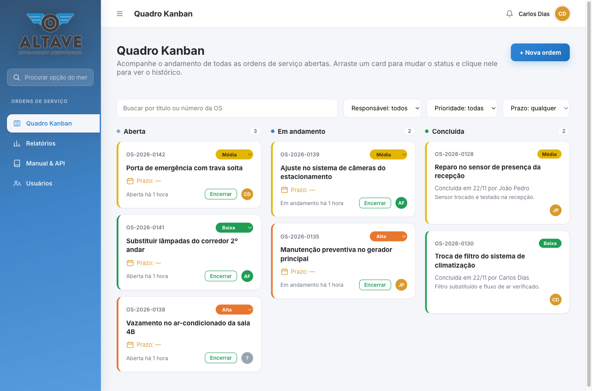
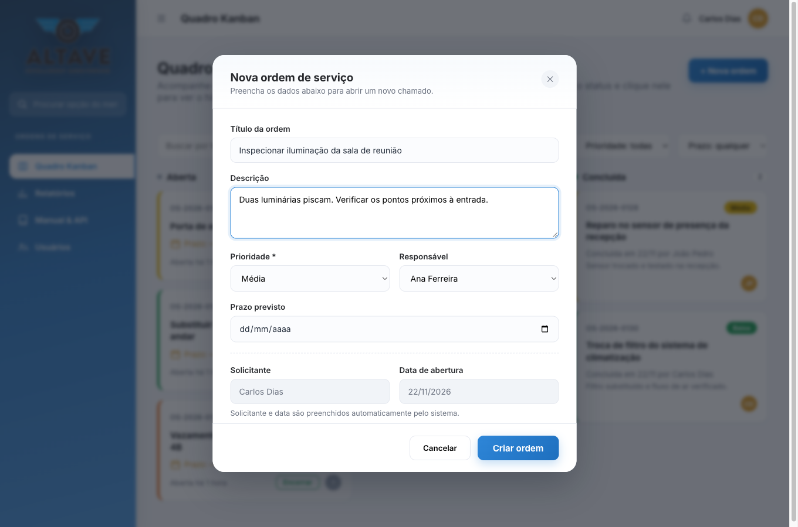
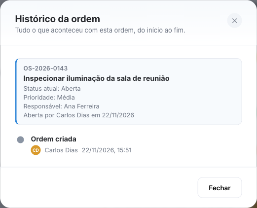
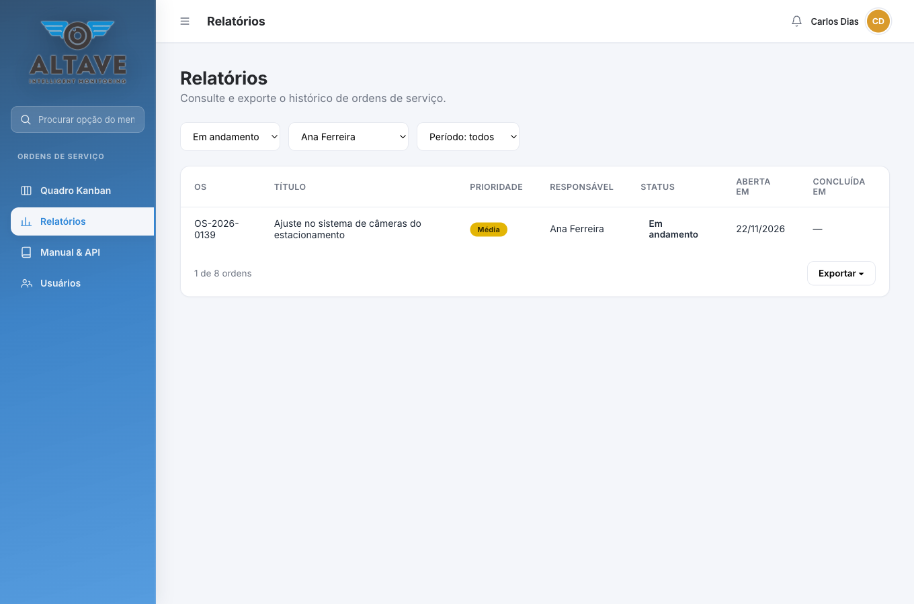

# Manual de Uso do Sistema — Altave

Guia para quem usa a Central de Ordens de Serviço. As telas abaixo foram capturadas com dados fictícios.

## Encontre o que você precisa

- [Entrar e navegar](#entrar-e-navegar)
- [Criar uma ordem de serviço](#criar-uma-ordem-de-serviço)
- [Localizar uma ordem e consultar seu histórico](#localizar-uma-ordem-e-consultar-seu-histórico)
- [Atualizar ou encerrar uma ordem](#atualizar-ou-encerrar-uma-ordem)
- [Consultar e filtrar relatórios](#consultar-e-filtrar-relatórios)
- [Exportar um relatório](#exportar-um-relatório)
- [Resolver dúvidas comuns](#resolver-dúvidas-comuns)

## Entrar e navegar

1. Abra o endereço da Central de Ordens de Serviço fornecido pela equipe.
2. Preencha **Email** e **Senha** com sua conta interna e clique em **Entrar**.
3. Use o menu lateral para abrir o **Quadro Kanban** ou **Relatórios**. Se o menu estiver recolhido, clique no botão **Menu** no topo.
4. Para sair, clique no seu nome ou avatar no canto superior direito.

O Kanban organiza as ordens em três colunas: **Aberta**, **Em andamento** e **Concluída**. Cada cartão mostra o código da OS, o título e a prioridade.

## Criar uma ordem de serviço

1. No **Quadro Kanban**, clique em **+ Nova ordem**.
2. Em **Título da ordem**, descreva o problema em uma frase. Em **Descrição**, informe o local, o que está acontecendo e o que precisa ser verificado.
3. Escolha a **Prioridade**. Se já souber quem vai atender a demanda, selecione a pessoa em **Responsável**. Caso contrário, deixe **Não atribuído**.
4. Confira **Solicitante** e **Data de abertura**, preenchidos pelo sistema, e clique em **Criar ordem**.
5. Confira o novo cartão na coluna **Aberta** e use o código da OS, como `OS-2026-0143`, para acompanhar a demanda.

## Localizar uma ordem e consultar seu histórico

1. No Kanban, digite parte do título ou o código da OS no campo **Buscar por título ou número da OS**.
2. Se precisar restringir a busca, use o seletor de **Prioridade**.
3. Abra o cartão para consultar o **Histórico da ordem**. Confira status, prioridade, responsável e os eventos registrados, com autor e horário.
4. Clique em **Fechar** para voltar ao quadro.

## Atualizar ou encerrar uma ordem

- Para iniciar o atendimento, arraste o cartão de **Aberta** para **Em andamento**.
- Se o botão **Editar** estiver disponível no cartão, abra-o, altere o campo necessário, escreva a justificativa e clique em **Salvar**.
- Ao finalizar o atendimento, clique em **Encerrar** no cartão. Preencha **Solução aplicada** com o que foi feito e confirme. A ordem passa para **Concluída**.
- Se uma OS concluída precisar voltar ao atendimento, solicite a reabertura a um Gestor ou Administrador.

A disponibilidade das ações varia conforme o perfil, o vínculo com a ordem e o status atual.

## Consultar e filtrar relatórios

1. Clique em **Relatórios** no menu lateral.
2. Em **Status**, escolha a situação desejada, como **Em andamento**.
3. Em **Responsável**, escolha uma pessoa. A tabela combina os critérios automaticamente.
4. Em **Período**, selecione **Últimos 7 dias**, **Últimos 30 dias** ou **Período: todos**. O período considera a data de abertura.
5. Confira o contador abaixo da tabela. Para voltar à lista completa, selecione **Status: todos**, **Responsável: todos** e **Período: todos**.

No exemplo, a combinação **Em andamento** e **Ana Ferreira** retorna apenas as ordens em andamento atribuídas a ela.

Se a sua versão mostrar **Aberta a partir de** e **Aberta até**, use esses campos para indicar a primeira e a última data de abertura a incluir. Você pode preencher só um dos limites. Na mesma versão, **Limpar Filtros** volta os campos ao padrão e recarrega a lista completa.

## Exportar um relatório

1. Em **Relatórios**, aplique os filtros desejados.
2. Clique em **Exportar** no fim da tabela.
3. Escolha **CSV** ou **Excel (.xlsx)**.
4. Abra o arquivo baixado no navegador. A exportação recebe os critérios que estavam selecionados ao iniciar o download.

## Resolver dúvidas comuns

| Situação | O que fazer |
| --- | --- |
| Não consigo entrar | Confira se digitou o e-mail completo. Se a conta ou a senha precisar de ajuste, fale com o administrador. |
| Não encontro a OS no Kanban | Limpe a busca e a prioridade. Procure novamente pelo código completo e confira as três colunas. |
| Relatórios mostra “Nenhuma ordem encontrada” | Revise a combinação de status, responsável e período. Restaure os filtros para ver todas as ordens disponíveis. |
| Uma ação ou um item de menu não aparece | Confira com o administrador se seu perfil tem acesso e se o status da ordem permite a ação. |
| O download não apareceu | Consulte a lista de downloads do navegador e verifique se o arquivo foi bloqueado. |
